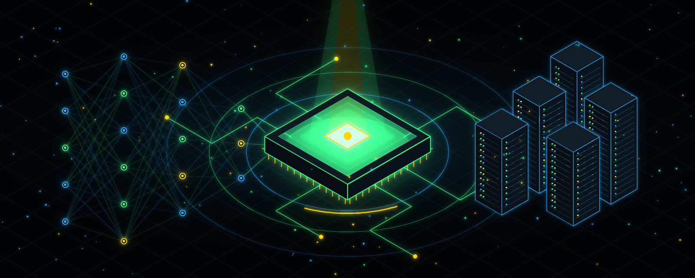
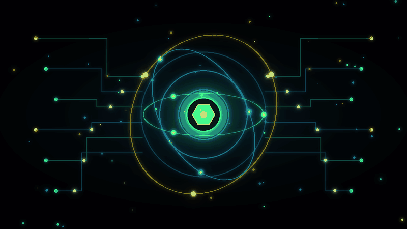
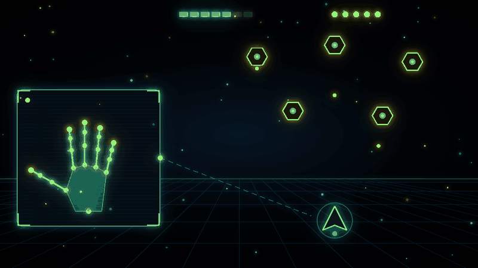
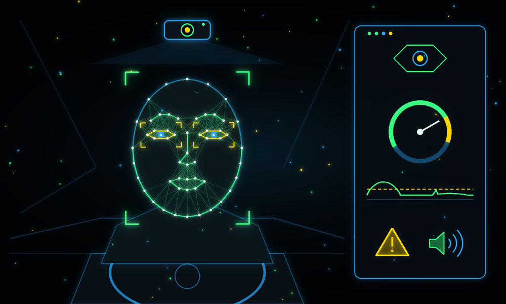
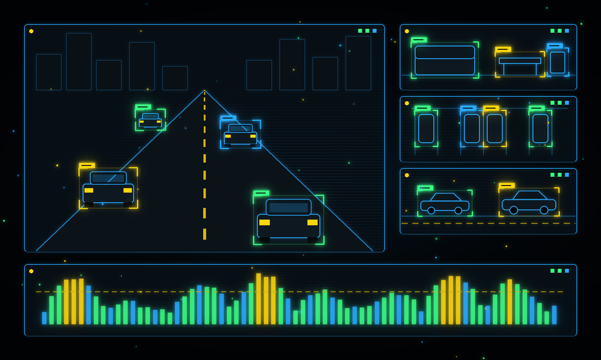
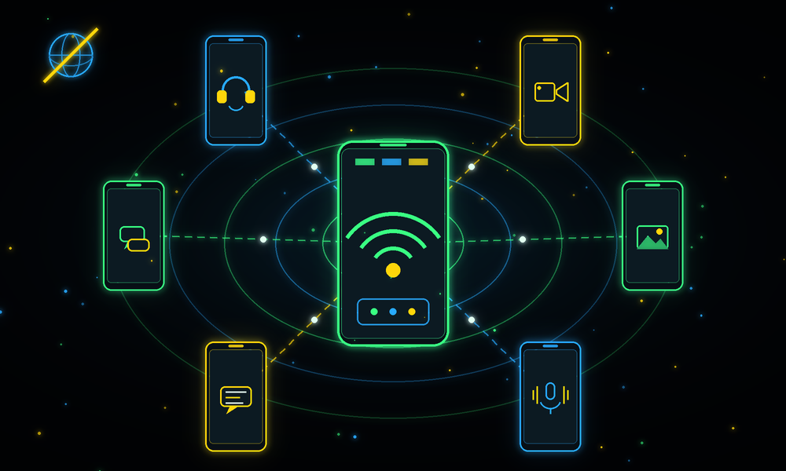
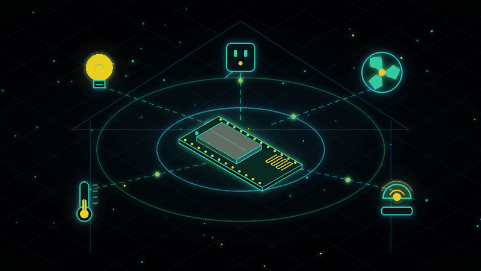

  
   
  <h1>Hi, I'm Adeeb Abukmail 👋</h1>
  <h3>Aspiring Developer · AI &amp; Computer Vision · Cybersecurity</h3>
  
<b>AI · Machine Learning · Computer Vision · Robotics · Cybersecurity · Server Automation</b>

  
<i>Turning curiosity into projects, one experiment at a time.</i>

  

---

## About Me

I'm an aspiring developer. I work with software and hardware together to explore technical ideas, develop practical prototypes, and build projects across artificial intelligence, computer vision, networking, and embedded systems. My interests span artificial intelligence, machine learning, computer vision, cybersecurity, server automation, robotics, mechatronics, electronics, programming, mathematics, and intelligent automation.

I learn by experimenting, building prototypes, testing ideas, and improving projects step by step. The project descriptions below distinguish work I have developed from prototypes and ideas that are still evolving.

## Technical Interests

- Artificial intelligence and machine learning
- Computer vision and gesture-based interaction
- Cybersecurity, networking, server automation, and Linux tools
- Robotics, mechatronics, and embedded systems
- Electronics, sensors, and intelligent automation
- Programming, mathematics, and problem solving

## Skills I'm Building

- Python programming and project integration
- Building servers and web games powered by artificial intelligence and computer vision
- Working with mobile hotspots, local wireless networks, radio-wave communication concepts, and connected devices
- Debugging, testing, and improving software in stages
- Exploring electronics, sensors, and embedded-device workflows

*This is a learning-focused overview, not a claim of professional proficiency.*

## Technologies & Tools

  
  
  
  
  
  
  
  
  
  
  
  
  
  
  
  
  

---

## My Projects

<table>
  <tr>
    <td width="50%" valign="top">
      <h3>🎮 AI & Computer Vision Hand-Controlled 2D Game</h3>
      
      
An example of my AI and computer-vision work: a 2D game that combines artificial intelligence with camera-based hand-gesture recognition as its way of interacting with the player.

    </td>
    <td width="50%" valign="top">
      <h3>🚗 AI Driver Monitoring & Drowsiness Detection</h3>
      
      
<b>Status: Implemented prototype</b>

      
The Driver Safety project utilizes computer vision to monitor the state of the driver's eyes, triggering an audible alert if the eyes remain closed beyond a specific threshold. The system also analyzes gaze direction and head orientation, detects the presence of a mobile phone, and supports integration with Arduino, ESP, and smartphones; it is also ready for deployment on Raspberry Pi.

    </td>
  </tr>
  <tr>
    <td width="50%" valign="top">
      <h3>📷 AI Camera Surveillance System</h3>
      
      
<b>Status: Prototype / in development</b>

      
A collection of computer-vision projects using custom-trained Ultralytics YOLO models to detect and identify objects in images or video. My experiments cover different object categories, including vehicles and furniture, with each project tailored to its intended detection task.

    </td>
    <td width="50%" valign="top">
      <h3>📱 Offline Hotspot Chat & Real-Time Communication</h3>
      
      
I developed an offline chat-room project that is hosted directly on my phone through its mobile hotspot. It does not require a computer or an internet connection: other phones join the hotspot's local wireless network and communicate over it rather than through the public internet.

      
The design targets approximately 10–20 connected devices, and its intended features include live audio calls, video calls, image sharing, voice messages, and text messages. These figures are design targets, not the results of verified large-scale testing.

      
I have not published the source code, because I want to reduce the risk of misuse, including its potential use for cheating during examinations. If you are interested in obtaining the code, you can contact me at <a href="mailto:adeebabukmail58@gmail.com">adeebabukmail58@gmail.com</a>.

    </td>
  </tr>
  <tr>
    <td colspan="2" valign="top" align="center">
      <h3>🔌 Smart Automation & IoT Projects</h3>
      
      
I have developed several IoT projects, including a smart-home project that uses an ESP-based device for controlling connected appliances. My broader work and experiments involve electronics, sensors, microcontrollers, and wireless automation.

    </td>
  </tr>
</table>

---

## Connect With Me

  
  
  
  

---

  
  
<b>Learn continuously · Build thoughtfully · Make technology useful</b>

  I organize my projects into single-file implementations whenever practical, following a request to make them easier for others to run, test, and explore.

